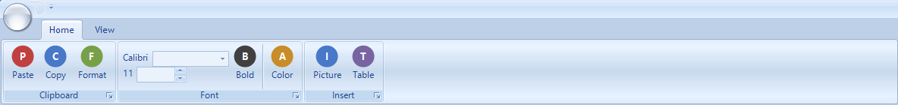

# RibbonWinForms for .NET 10

[](https://github.com/DwainSnickles/RibbonWinForms/actions/workflows/build.yml)

An Office-style ribbon control for Windows Forms, ported to **.NET 10** and repaired so it works
both at runtime and inside the **out-of-process WinForms designer** that current Visual Studio uses.

This is a fork of [RibbonWinForms](https://github.com/RibbonWinForms/RibbonWinForms) (MS-PL, originally
by Jose Menendez Poo). Upstream targets .NET Framework 4.8; this fork moves the library to
`net10.0-windows` and fixes the things that port broke.



## What this fork changes

**It runs.** The ribbon paints its tabs, panels, items, quick access toolbar, contexts and orb, and it
handles mouse input — the same as on .NET Framework.

**It designs.** The old fixed-in-process designer is gone. This fork implements a designer against the
out-of-process design server:

- Click a **tab**, a **panel** or an **item** on the design surface to select it and edit it in the
  Properties window.
- Three pills on the surface add structure without hunting through verbs: **Add Tab**, **Add Panel**,
  and **Add Control** (which opens a menu of Button, Combo Box, Text Box, Check Box, Up Down, Label,
  Button List, Item Group, Color Chooser, Host and Separator).
- The item collections have real **collection editors** in the Properties grid, so panels, items, orb
  entries, button lists and the quick access toolbar can be edited visually instead of by hand.
- Everything written into `Form1.Designer.cs` is ordinary, readable `new RibbonTab()` / `Panels.Add(...)`
  code — no custom serialization to unpick later.

**It keeps design-time code out of your app.** A deployed app must never load
`Microsoft.DotNet.DesignTools.Server`, which only exists inside Visual Studio. This fork makes sure
nothing on a runtime path names a design-time type — the designer and editors are referenced by *name*
in attributes, the ribbon reaches its designer through a plain object registration, and an assembly
resolver lets the design server satisfy the reference whatever version it hosts. Without this, the
first mouse move over the ribbon threw `FileNotFoundException: Could not load file or assembly
'Microsoft.DotNet.DesignTools.Server, Version=1.6.0.0'` and took the app down.

## Requirements

| | |
|---|---|
| Runtime | Windows, .NET 10 (`net10.0-windows`) — nothing else |
| Design-time | Visual Studio with the WinForms designer (the out-of-process design server) |
| Build | .NET 10 SDK |

The library compiles against `Microsoft.WinForms.Designer.SDK` 1.6.0, which supplies the design-time
types at compile time only. At design time the code runs against whichever design-tools build your
Visual Studio hosts; nothing from that package is shipped to your application.

## Quick start

```csharp
using RibbonLib;

var ribbon = new Ribbon { Dock = DockStyle.Top };

var tab = new RibbonTab { Text = "Home" };
var panel = new RibbonPanel { Text = "Clipboard" };

var paste = new RibbonButton
{
    Text = "Paste",
    Image = Properties.Resources.Paste,
    LargeImage = Properties.Resources.PasteLarge
};
paste.Click += (s, e) => MessageBox.Show("Paste");

panel.Items.Add(paste);
tab.Panels.Add(panel);
ribbon.Tabs.Add(tab);

Controls.Add(ribbon);
```

Use `RibbonForm` instead of `Form` if you want the ribbon merged into a glass caption bar.

## Working in the designer

1. Drop a `Ribbon` on the form (it docks to the top).
2. Click **Add Tab**, then **Add Panel** on the tab you just made.
3. Click **Add Control** on a panel and pick the item type from the menu.
4. Select any tab, panel or item to edit it in the Properties window.
5. For collections (`Tabs`, `Panels`, `Items`, orb collections, `Buttons`, quick access items), use the
   collection editor from the Properties window — add, remove and reorder there.

## Building

```
dotnet build RibbonLib.slnx
```

Open `RibbonLib.slnx` in Visual Studio to work on the designer itself. Design-time behaviour can only be
exercised inside Visual Studio; the runtime behaviour can be tested from any app that references the
project.

## How the design-time support is put together

| Piece | Role |
|---|---|
| `Classes/Designers/RibbonDesigner.cs` | The ribbon designer: selection, the Add pills, the Add Control menu, the Properties verbs |
| `Classes/RibbonItemCollectionEditor.cs` and friends | Collection editors for the item collections |
| `Classes/RibbonDesignTime.cs` | The runtime-safe bridge. Runtime code talks to the designer as a plain `object`, so no design-time type is ever named on a runtime path |
| `Classes/RibbonDesignToolsResolver.cs` | Answers design-tools assembly requests with the copy the IDE has loaded, whatever its version |
| `Classes/Glyphs/` | Design-surface decorations (orb, quick access toolbar, Add pills) |

## Known limitations

- **Design-time only features.** Selection, pills, the Add Control menu and collection editors exist
  only in the Visual Studio designer. Applications use the plain runtime API.
- **Design-tools versions are independent of this package.** The package that provides the compile-time
  designer types (1.6.0) and the design server inside Visual Studio carry different assembly versions;
  the resolver in this fork bridges that. If a future Visual Studio changes the designer API, the
  designer code may need updating — the runtime will be unaffected.
- **No NuGet package.** Build the project or reference it directly.
- Binding a runtime `PropertyGrid` to a `Ribbon` can throw `ArgumentNullException` while it walks the
  ribbon's collections (observed during this port). The designer's own property grid is not affected.

## Credits and license

This library is the work of **Jose Menendez Poo** and the [RibbonWinForms](https://github.com/RibbonWinForms/RibbonWinForms)
contributors, with later maintenance by the OfficeRibbon project. This fork adds the .NET 10 port and the
out-of-process designer support described above.

Licensed under the **Microsoft Public License (Ms-PL)** — see [LICENSE](LICENSE).
